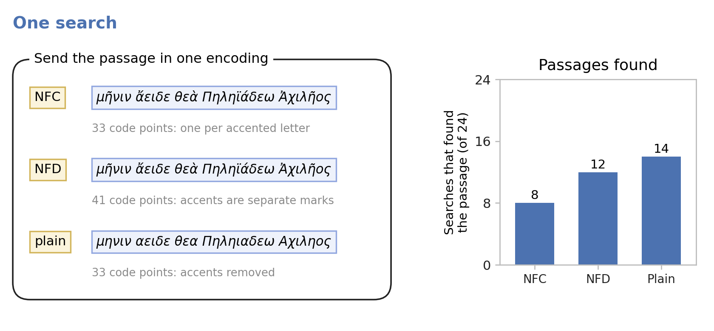
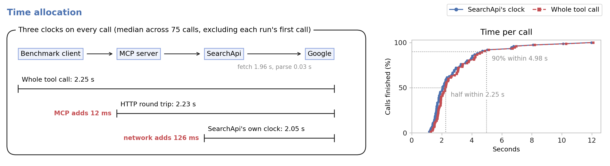
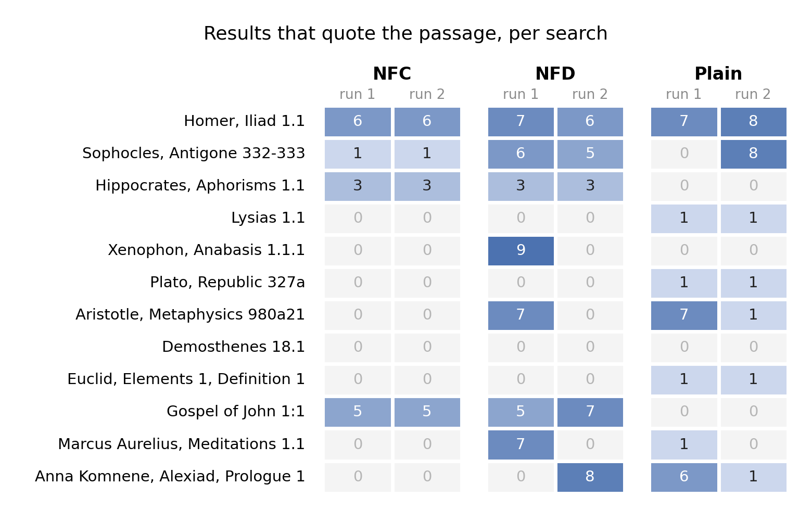
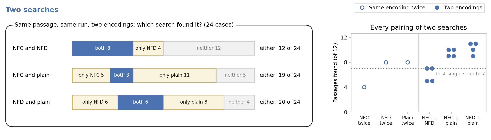

# Polytonic Greek quotation and revtrieval with SearchApi

Search retrieval with historical and non-Latinate languages is not straightforward. People may increasingly use LMs for source attribution. But LMs often attribute from memory, or when incapable of answering from memory, hallucinate. Web search may ground
an attribution, but that requires actually locating the source, which can be affected by the text's encoding. This repo reports a small illustrative experiment of to illustrate the problem of encodings using [SearchApi](https://www.searchapi.io/)'s Google engine behind an MCP tool to retrieve multiple polytonic Greek passages of varying canonicity.

## Encoding polytonic Greek

Greek text reaches search tools in three prinicipal forms:

| Form | Query | Code points |
| --- | --- | --- |
| NFC | μῆνιν ἄειδε θεὰ Πηληϊάδεω Ἀχιλῆος | 33 |
| NFD | μῆνιν ἄειδε θεὰ Πηληϊάδεω Ἀχιλῆος | 41 |
| Plain | μηνιν αειδε θεα Πηληιαδεω Αχιληος | 33 |

- **NFC** stores each accented letter as one character: *ῆ* is U+1FC6. Most
  digital editions use this.
- **NFD** stores a letter and its accents separately: *ῆ* is *η* (U+03B7)
  followed by a combining accent (U+0342). Text extracted from PDFs, as well as some other formats and tools, arrives this way.
- **Plain** has no accents or breathings. A keyboard without polytonic input
  produces it. Many diplomatic transcriptions of papyri and inscriptions use this. Because subword and other tokenization methods are poorly optimized for accents, many LM projects for premodern Greek use plain text as well.

## Research question

The experiment addresses two principal questions:

- Does a query's encoding change what Google returns?
- How long does retrieval take, and how is that time allocated? 

Though this experiment focuses on polytonic Greek, the same questions apply to other inflectional languages with optional marks, such as Vietnamese, pointed Hebrew, or classical Arabic.

## Experiment

I put [SearchApi](https://www.searchapi.io/)'s Google engine behind an MCP tool
that queries the source for a line of premodern Greek.

**Data.** Twelve opening lines, from Homer to Anna Komnene's
twelfth-century *Alexiad*, spanning genres—epic, tragedy, oratory, history, philosophy,
medicine, mathematics, and the New Testament.
[passages.json](passages.json) contains all twelve lines, each in NFC, NFC, and plain encoding. [queries.json](queries.json) contains the 36 requests built from them with ready-made URLs.

**Queries.** As typical of any MCP host, a benchmark client starts the server over stdio and calls the tool once per passage per encoding, shuffling the order. I run this grid twice, approx. 110 minutes apart. I also repeat one query five more times in a row. In all: 77 calls.

**Time.** I time each query three qays:

1. SearchApi's own `total_time_taken` in the response.
2. The HTTP round trip, timed in the server.
3. The whole tool call, timed in the client.

Time 2 minus clock 1 is network time. Time 3 minus clock 2 is what MCP adds.

**Scoring.** I use a partial matching for attribution—source *quotes* a passage if its title or snippet contains
at least 80% of the passage as a single, unbroken string, insensitive to accents, case, spaces, and punctuation. The reason for ignoring the latter is they are variable editorial markings. A search successfully retrieves the passage if at least one result quotes it as described.

### Results

- A call took a median of 2.25 seconds. Nearly all of that was SearchApi
  fetching the page from Google. The MCP layer added 12 milliseconds.
- How accents are encoded (NFC or NFD) made no measurable difference to
  what Google found.
- Removing accents returned almost entirely different pages. Searching both
  with and without accents found the passage in 20 of 24 trials, against 14 for
  the best single search.

*Figure 1. Left: one line of the Iliad in three tested encodings. NFC and NFD
look the same but are different characters. Right: searches in which at least
one result quoted the passage.*

### Latency

*Figure 2. Left: the path of one call and what each clock covers. Right: the
share of calls finished within a given time. The two curves nearly coincide
because almost nothing is added outside SearchApi.*

| Clock (75 calls) | Median (s) | 90th percentile (s) | Max (s) |
| --- | --- | --- | --- |
| SearchApi's own clock | 2.05 | 4.83 | 11.97 |
| HTTP round trip, in the server | 2.23 | 4.96 | 12.07 |
| Whole tool call, in the client | 2.25 | 4.98 | 12.09 |

- SearchApi spent its time fetching the page from Google: a median of 1.96 s,
  against 0.03 s to parse it.
- The network added a median of 126 ms. The MCP layer added 12 ms, and at most
  45 ms across these 75 calls.
- Seven of the 75 calls took longer than 5 s.
- The query form made no difference. The medians were 2.28 s (NFC), 2.25 s
  (NFD), and 2.17 s (plain).
- The table leaves out the first call of each run, which also opens the
  connection. Those two calls took 1.51 s and 1.91 s, no slower than the rest
  in total, but their MCP overhead was higher: 95 ms and 117 ms.

### Finding the passage

Only 34 of the 72 grid searches found the passage.

| Query form | Run 1 | Run 2 | Both runs |
| --- | --- | --- | --- |
| NFC | 4/12 | 4/12 | 8/24 |
| NFD | 7/12 | 5/12 | 12/24 |
| Plain | 7/12 | 7/12 | 14/24 |
| NFD and plain, merged | 11/12 | 9/12 | 20/24 |

*Figure 3. Every grid search.*

Two examples from Figure 3:

- **The same query, two answers.** The NFD query for Xenophon's line returned
  nine quoting results in run 1, among them a commentary
  (geoffreysteadman.com) and the Loeb edition. In run 2 the same query returned
  none. The top two results were Perseus pages with the snippet "No information
  is available for this page."
- **Each form finds what the other misses.** The NFD query for John 1:1
  returned pages quoting the verse, at rank 1 in both runs. Without accents,
  the query returned modern Greek pages about the Gospel (wol.jw.org,
  bible.com), and none quoted the verse. Plato's line went the other way: only
  the plain query found it, at rank 1 in both runs.

### Run-to-run variation

The same query sent twice shared only about half of its results. Overlap here
is the share of results two lists have in common: results in both, divided by
results in either.

| Result lists compared | Mean overlap |
| --- | --- |
| NFC, run 1 against run 2 | 0.65 |
| NFD, run 1 against run 2 | 0.44 |
| Plain, run 1 against run 2 | 0.51 |
| NFC against NFD, same run | 0.48 |
| NFC against plain, same run | 0.07 |
| NFD against plain, same run | 0.10 |

The found-or-not verdict flipped between runs for 6 of 36 queries. Even the
*Iliad* line, sent six times within two minutes, averaged 0.65 overlap between
calls.

## Discussion

**NFC and NFD behave alike.** Their result lists overlap (0.48) about as much
as one query overlaps with itself across runs (0.44 to 0.65). NFD found the
passage in 12 searches against 8 for NFC, but the whole gap comes from four
passages that each flipped once. An exact sign test across passages gives
p = 0.125, so the gap may be chance. SearchApi passes the bytes through
unchanged: 1,532 decomposed code points sent, 1,532 echoed back. Any
equivalence is Google's doing. A tool does not need to convert between the two.

**Removing accents makes a different query.** Plain lists share a tenth or
less of their results with accented ones, and each finds what the other
misses. Plain found Lysias, Plato, and Euclid in both runs, where no accented
search did. Accented searches found John and Hippocrates in both runs, where
plain never did. One NFD search merged with one plain search found the passage
in 20 of 24 trials, against 14 for the best single form.

*Figure 4. Left: for each pair of encodings, the 24 cases (12 passages × 2
runs) split by which of the two searches made in the same run found the
passage. Right: passages found by every way of pairing two of the six searches
made for each passage. The dotted line marks the best single search.*

**One search is not evidence.** A single query found a famous opening line
less than half the time. An agent should not read an empty result as "this
text is not online." The fix this data supports is to send the passage both
ways and merge the results. That costs two credits, and the two calls are
independent, so they can run at the same time.

**The latency is upstream.** MCP adds 12 ms to a two-second call, so there is
nothing to tune in the server. Plan for the slow calls instead: roughly one in
ten took more than 5 s, and the slowest took 12 s.

**Two notes for tool builders.** In 562 of 669 results, `link` was a Google
redirect URL, not the page URL. That is why the tool also returns `domain`.
And trimming the response cut the median payload from 28.0 kB to 6.4 kB, which
matters when a model pays for every token it reads.

A search API is what makes this measurable. For 77 credits, SearchApi returned
77 parsed, timestamped result pages. That was enough to show that results for
a rare script change from call to call. The same test works for any script
with optional marks.

## Limits

- The sample is 12 passages and two runs. The differences between single forms
  are suggestive, not significant.
- Many, if not all, of the 12 are famous opening lines. Lines from the middle of a text should be
  harder to find.
- Scoring reads titles and snippets only. A page can contain the passage
  without its snippet showing it.
- Everything ran through one engine and locale: `engine=google`, `gl=us`,
  `hl=en`.
- Demosthenes 18.1 was never found, in any form.
